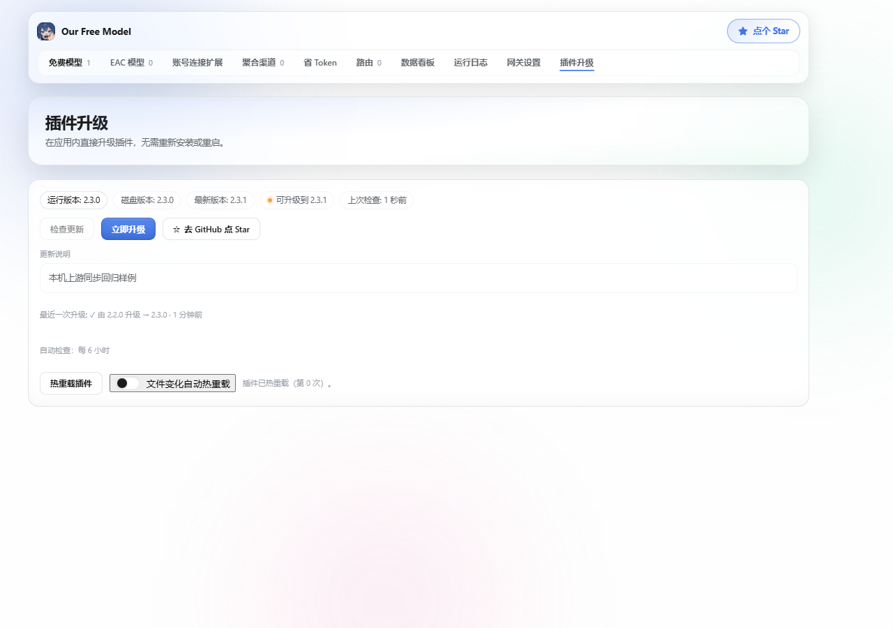
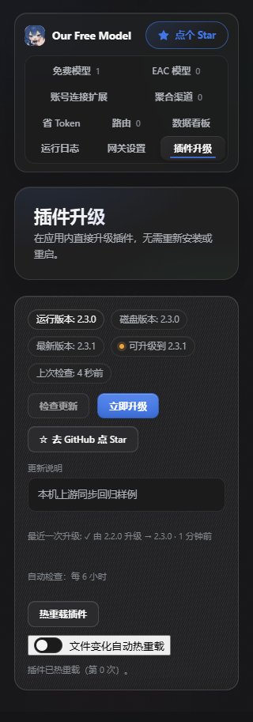
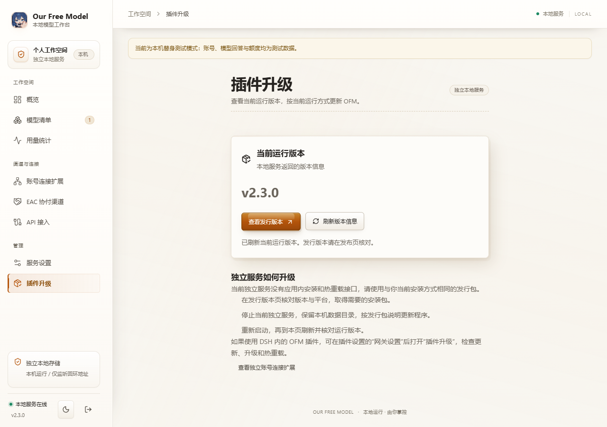
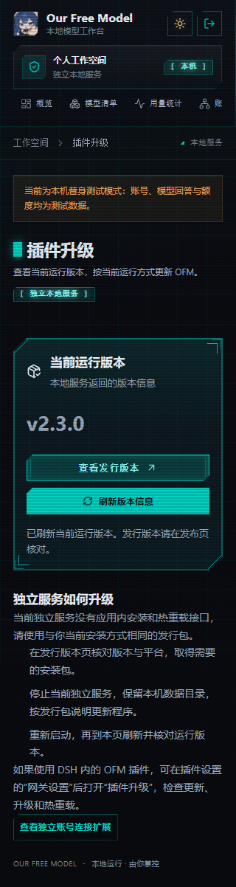
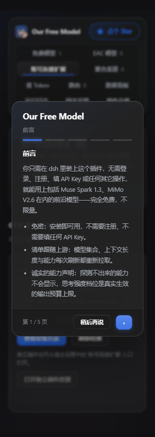
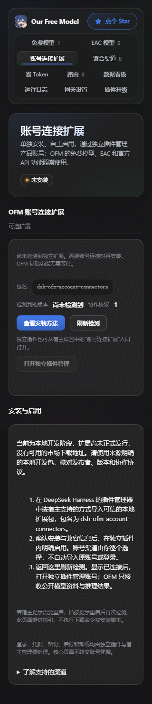
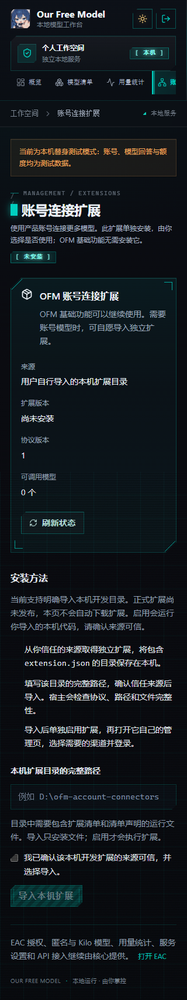

# 分离版跟进上游 2.3.0：分支提交说明

## 目的 Purpose

这次把拆分后的 OFM 和独立账号插件跟进到上游 `2.3.0`，基准是 `ac4c55ef5e0833bf0138846a7c5255ecbc14a07c`。想解决的是：上游继续更新了，拆开后的两个插件也要接得上，原来打磨过的界面和渠道修复也要留住。

主要同步了免费车道的新协议与错误分类、会话保存、独立的“插件升级”导航和首次公告弹层。上游这批没有修改账号渠道源码，账号扩展保留已有修复，重新构建并接新核心验证。

## 架构与范围 Architecture & Scope

项目没有正式的 L1/L2/L3 划分，按实际边界说明：DSH 核心插件、共享模型运行时、独立账号插件/Worker、独立网页和 Tauri 桌面。

- 核心只保留账号插件的安装/状态指引和可选协作接口；EAC、匿名免费、Kilo、官方 API、核心网关、路由、省 Token、用量和日志继续保留。
- 十三项账号接入及登录、续期、签到、余额等业务由独立插件管理，安装及各渠道首次默认关闭。
- 插件保留上游升级入口；独立服务显示实际版本和安装包升级指引，不提供虚假的应用内升级接口。
- 会话映射改为跟随各自数据目录，避免独立服务/桌面与 DSH 混用；补齐 Messages 探测的工具格式。
- 升级前检查分离结构，拒绝重新内置账号模块的整合包，避免两个插件重复注册。原签名验证和公钥保持。
- 核心分支为 `sync/separated-upstream-20261015`，扩展分支为 `sync/account-connectors-20261015`。两仓分别整理一个本轮提交，主线不合并。

## 风险与兼容 Risks & Compatibility

这是开发验收分支。上游签名清单描述的是原始整合包，不能覆盖当前定制字节；分离树的发行清单检查不通过，需要维护者对最终候选重新准备正式签名。没有伪签、跳过验签或更换信任根。Windows 安装器也未签名。

十三项真实账号的登录、额度、续期和现网生成还没有全部验收；合成账号和本地网关通过，不等于厂商现网全通。用户正式 DSH、原生 Tauri 窗口和安装向导本轮未操作。

浏览器验收独立为 `npm run test:ui-parity`，需要 Playwright、Chromium/Edge 和 standalone 依赖。原代码 CI 不安装依赖，不能直接在其中运行浏览器测试；单独验收和实际截图均保留。

## 验证 Verification

- [x] 已完成本轮相关构建、回归、类型检查、双包联装及独立审查；team-mode 未另规定命名的最低验证级别。
- [x] 两仓 `git diff --check` 与 `git diff --cached --check` 通过。
- [x] 提交范围经过检查，不包含用户账号、日志、私密备份、密钥、模型缓存或本机依赖；开发制品单独标注。
- [x] UI 提供真实浏览器截图，数据为隔离测试样例。
- [x] 未验证项已列出。
- [ ] 正式发行签名/定制树 `manifest:check`：未完成，原因见风险章节。
- [ ] 正式用户 profile、十三项全部真实账号和原生桌面窗口：未验。

| 实际执行的命令或动作 | 结果 |
| --- | --- |
| `node scripts/test-all.mjs --mode contributor` | 提交前将浏览器组独立后，代码组 **52/52**；前轮含浏览器组为53/53 |
| `node scripts/separated-updater-test.mjs` | 7/7，涵盖临时真签名、正常分离更新、整合包拒绝、临时换包和 Windows 路径别名 |
| `node scripts/upstream-session-isolation-test.mjs` | 3/3，实际双 HTTP 服务、目录隔离和新 Node 进程恢复 |
| `node scripts/free-channel-contract-test.mjs` | 15/15，真实流解析、错误合同、Messages 工具格式 |
| 扩展 `npm run build`、`npm run check`、`node scripts/smoke-worker.mjs` | 通过，35项哈希文件、6个UI资源、初始13渠道关闭/0模型 |
| 扩展 `node --test --test-concurrency=1 --test-reporter=tap tests/*.test.mjs`，指定新核心和真实官方SDK公共模块 | 449/449，零失败/跳过/取消；SDK版本0.2.0-rc.2 |
| `node scripts/upstream-ui-parity-test.mjs` | 20项、34张截图；插件/独立网页昼夜、320/390/1280、公告portal |
| `node scripts/standalone-react-ui-test.mjs` | 13组、38张截图；包含200%缩放和扩展窄屏 |
| `node scripts/ui-preview.mjs --themes light,dark` | 48张页面截图和1项交互；无空白、浏览器错误或整页横向溢出。缺少宿主主题包时使用明确标注的测试配色 |
| 核心/standalone typecheck；`node scripts/build-standalone-ui.mjs --check` | 通过 |
| `npm pack --ignore-scripts`；实际tgz/Worker联装 | 核心72/扩展35文件与源码一致；启停、重启、卸载保留数据通过 |
| `node scripts/account-connectors-package-integration-test.mjs`，指定实际外置目录 | 5/5，经核心认证HTTP管理入口 |
| 官方DSH 0.2.0-rc.2 CLI离线安装双包，并在独立profile启动 | 17项通过；真实服务注册、撤出、定时器和句柄释放 |
| `tauri build --ci --no-sign --bundles nsis -- --locked --offline`；7-Zip解包和包内后端启动 | Windows x64成功；82个服务资源一致；内置Node空PATH、认证、扩展联装及退出通过；未运行安装器/原生窗口 |
| `node scripts/build-manifest.mjs --check` | 未通过，如实保留为开发候选的正式发行限制 |

真实界面证据：

## 配置与迁移 Configuration & Migration

旧整合核心更新到本分离版时，会随签名配套载荷自动安装独立账号插件，并将旧账号索引、凭据和持久化渠道数据迁移到独立目录；迁移失败回滚且保留旧数据，重复启动幂等。只有手动单独安装扩展时，才需要用户自行导入/预览备份。两个插件同时存在时可联动，停用一方不删除另一方。

独立网页/桌面使用外置扩展ZIP，解压后导入含 `extension.json` 的完整目录。服务器数据库和授权应用本轮不迁移。

准确的配套分支、开发包地址和真实SHA256见[开发安装说明](../dev-install/README.md)。扩展仍为0.1.0，必须按校验值区分此前同版本候选；没有发布npm。

## 回退方式 Rollback

先停用独立账号插件，再恢复此前核心安装包及配置，按宿主提示重启。账号、EAC授权和会话数据保留；卸载扩展默认保留数据。本轮不包含生产部署，没有对用户环境做在线迁移。
