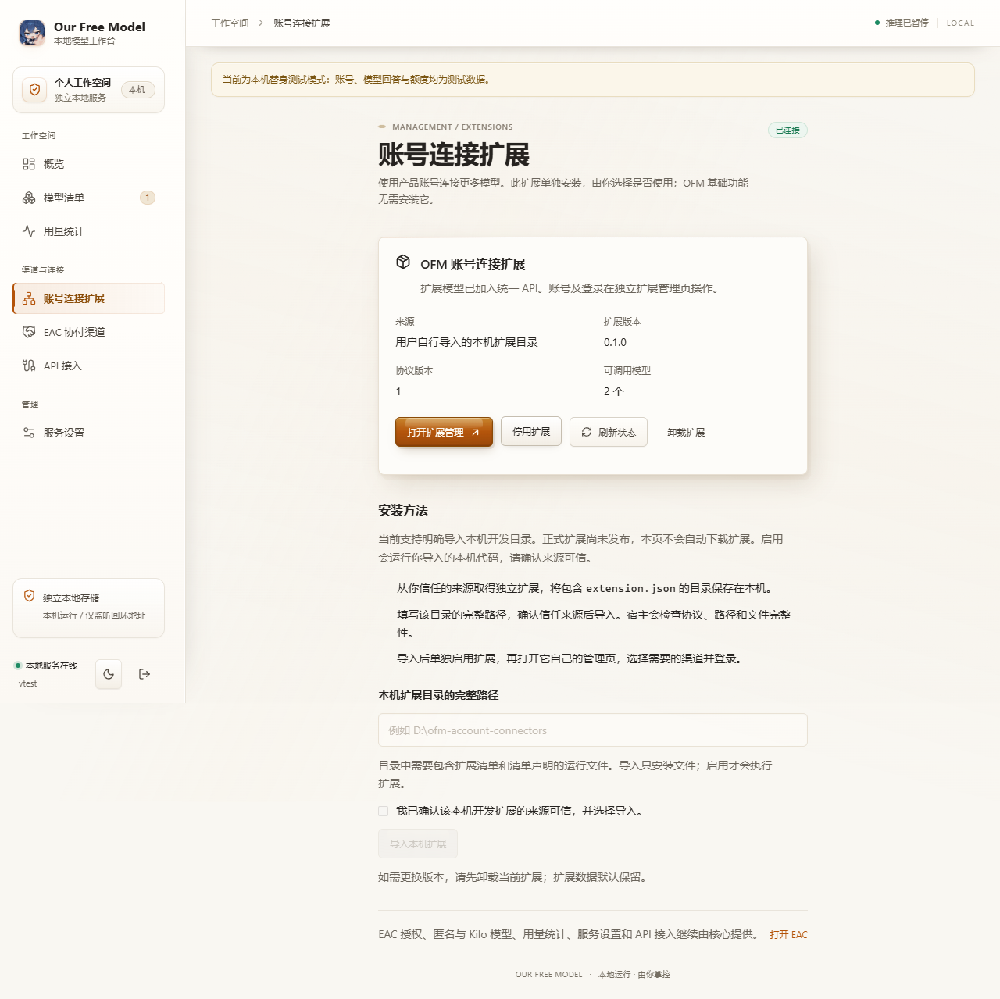
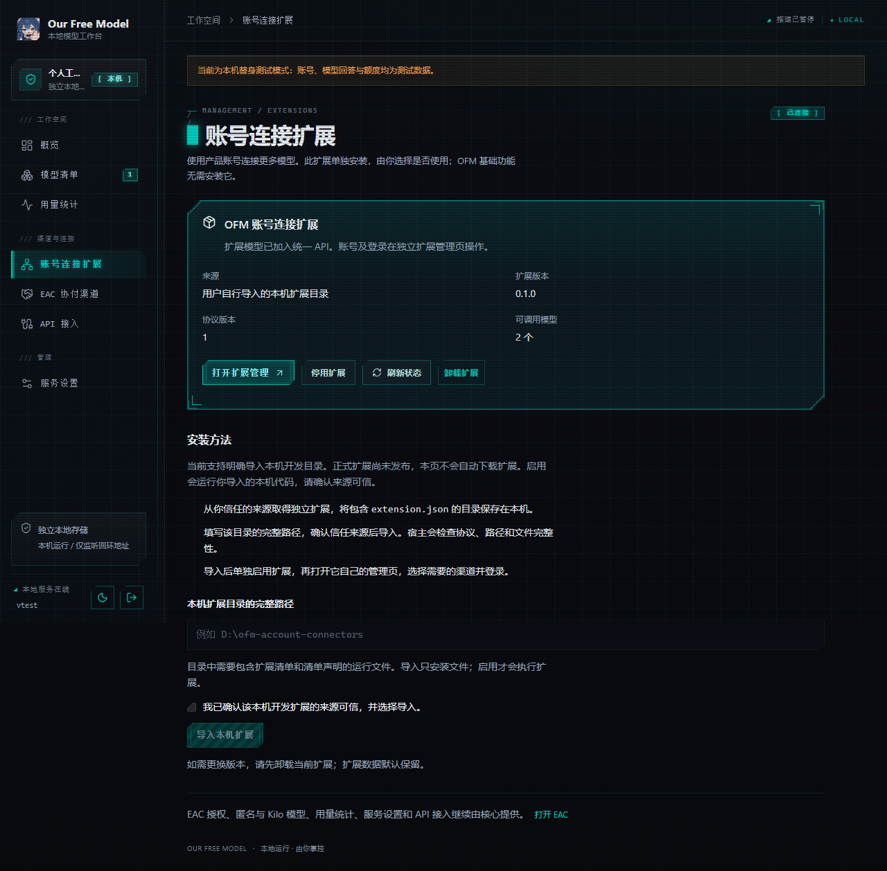
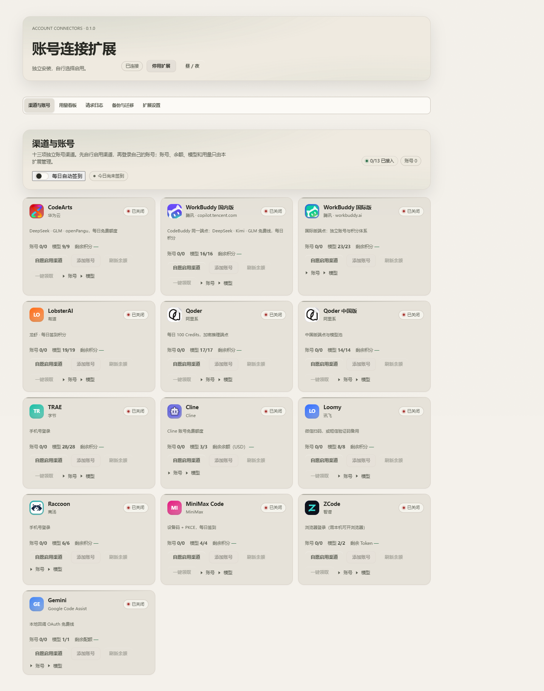
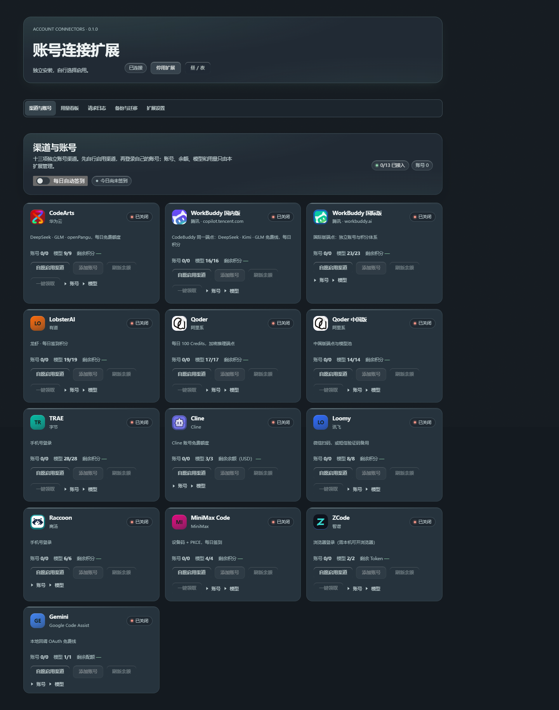

# 账号连接扩展拆分：验证与交接

日期：2026-10-14。核心分支refactor/separate-account-relays；独立扩展分支refactor/independent-account-connectors。核心开发起点为226a9ec，未合并上游main。

## 目的 Purpose

原来的账号登录和转接能力直接装在OFM里，用户无法单独选择。此次把十三项产品账号接入做成独立插件。OFM核心保留安装指引与可选连接，未安装扩展时继续使用EAC、匿名免费/Kilo、官方API、核心网关、路由和节省Token。

安装扩展后仍需主动启用，每个渠道初始关闭；账号登录、用量、日志、备份和后台任务由扩展管理。原来的账号页面变为扩展指引，现有昼夜主题保留。

## 架构与范围 Architecture & Scope

本项目没有以L1/L2/L3命名正式模块，按实际边界说明：DSH插件入口与可选服务、共享模型/API运行时、独立HTTP管理端和网页、Tauri资源与生命周期、独立账号运行包/Worker/清单。

核心移除vendor/channel-pack、内置standalone账号运行模块、账号专用网关/中继和对应前端；独立扩展持有这些业务、认证和专用WASM。核心EAC与账号前端依赖拆开，桌面只复制核心清单资源。合作接口传模型、请求、取消与状态，不传账号凭据。

服务器数据库、OAuth应用、用户profile与真实账号数据不在本分支写入范围。新站配置保留上游PR306密封配置。

## 风险与兼容 Risks & Compatibility

新旧账号模块同时运行会占用相同供应商，安装前应先替换旧整合版核心。扩展缺席/停用时旧账号模型明确不可用，不误转匿名；实际同名模型冲突返回409。

DSH宿主模型注册与OFM自己的API协作分别校验，核心退出只断开桥接。停用撤回模型、取消请求和后台任务；卸载默认保留数据。原账号文件留在原处，不自动接管或删除，迁移需要本机预览与确认。

源码许可不代替厂商服务授权。Worker不被描述为强安全沙箱。此分支和dev-install文件是开发验收制品，没有正式更新签名；不会改写维护者现有发行清单或伪造签名。

## 验证 Verification

- [x] Skill推荐的最低验证级别已完成：实现、独立审查、故障/取消回归与实际浏览器检查。
- [x] git diff --check已通过。
- [x] 上传范围已排除无关缓存、日志、凭据、用户数据和提取种子。
- [x] UI变化已提供实际截图；下方明确区分隔离状态与真实外置包联装。
- [x] 未验证项已明确列出。

| 实际执行的命令 | 结果与边界 |
| --- | --- |
| node scripts/test-all.mjs --mode contributor | 核心47/47套件通过；本机替身，不消耗厂商额度 |
| node scripts/account-connectors-plugin-test.mjs | 22项通过；模拟宿主服务，官方合同另有只读核对 |
| node scripts/account-connectors-host-test.mjs | 10项通过；真实本地Worker，安装/取消/卸载 |
| node scripts/account-connectors-lifecycle-test.mjs | 10项通过；服务代际、嵌套脱敏、进程退出、联接路径及跨来源路由 |
| node scripts/standalone-extensions-test.mjs | 17/17；未安装保留核心、鉴权、旧入口、真实Worker |
| node scripts/standalone-management-test.mjs | 16/16；会话、设置、密钥、取消、轮换与重启 |
| node scripts/standalone-test.mjs | 20/20；核心模型与Chat/Responses、缓存、监听和数据锁 |
| node scripts/core-extension-boundary-test.mjs | 5项；npm/独立/实际桌面暂存无账号业务与WASM |
| node scripts/desktop-test.mjs | 7/7；中文空格路径、内置Node、端口、登录、管道及退出 |
| node scripts/build-standalone-ui.mjs --check | 通过，8项网页资源与清单一致，无旧账号分包 |
| npm --prefix packages/standalone run typecheck | 通过 |
| node scripts/standalone-react-ui-test.mjs | 11/11组；真实编译网页，30张昼夜截图，320/390窄屏和200%缩放 |
| node scripts/ui-preview.mjs --browser msedge --themes light,dark | 九页昼夜共42张图；隔离React/Edge，无空白/脚本错误/横向溢出。主题包未在预览路径发现，回退配色标为fixture |
| npm --prefix packages/desktop run build | Windows x64可执行程序与NSIS安装包成功；安装程序已解包检查 |
| 设置OFM_ACCOUNT_CONNECTORS_PACKAGE后运行node scripts/account-connectors-package-integration-test.mjs | 5/5；使用实际扩展发行目录导入核心、握手、资源、停用和卸载 |
| 独立扩展npm run build / npm test / npm run check | 构建成功，26/26，35文件摘要与6项UI资源通过 |
| 独立扩展npm run pack:external / npm run pack:dsh | 成功生成外置包和DSH tgz |

真实核心新网关只读核对在2026-10-14 15:32完成：候选配置匹配新站，授权有效，签名清单返回六模型。本轮没有重新调用模型生成，不把目录成功当成全部模型可用。

未验证：用户真实DSH完整宿主的双插件安装/热装卸、十三家真实登录与推理、真实旧账号迁移。实际原生桌面窗口启动受自动审批限制，未将窗口/安装向导标为通过。正式发布签名、主线合并和生产部署未执行。

### UI视觉证据

核心安装卡使用真实编译网页和隔离API状态替身，图中的账号/模型数量不代表真实用户或已调用模型。

以下是实际外置包经核心管理服务导入、认证和渲染的扩展页面。没有真实账号，十三项关闭，模型数量为零。

## 配置与迁移 Configuration & Migration

核心与扩展分别安装。DSH的desktop profile由Electron管理，使用官方插件界面的安装地址，不用CLI向其他profile安装代替桌面。开发包地址与校验值在dev-install/README.md和checksums.json。

独立/桌面将外置zip解压，用包含extension.json的完整目录导入。首次安装不启用，各渠道首次关闭。旧数据保留，扩展内迁移先预览再确认；账号Key、Cookie、密码或私密备份不进入仓库。

别人重新构建：根目录按PACKAGING.md使用npm install --ignore-scripts --legacy-peer-deps；standalone/desktop各自使用锁文件。扩展npm ci --ignore-scripts后从vendor源代码构建。联合测试显式传核心仓库路径，浏览器使用现有Playwright/Chromium，不依赖作者个人目录。

## 回退方式 Rollback

先停用独立扩展，再恢复原核心安装包和原配置，按宿主提示重启。不要删除账号、EAC授权或用户会话。外置扩展卸载默认保留账号数据，重新安装可按用户选择恢复。核心故障不自动卸载独立DSH扩展。

本分支尚未改写用户实际安装或线上服务，当前没有因本次源码提交产生的数据库迁移。服务器旧历史接续由另一个对话维护，账号扩展拆分不代替旧服务器迁移。

### 上传时的OAuth修正

独立扩展移除了上游Google OAuth客户端常量，改读本机配置，新增缺配置在监听/联网前拒绝的测试；扩展26/26通过。核心外置Worker仅转交明确命名的Google扩展配置变量，不转交OFM服务器的GitHub OAuth Secret。GitHub保护规则未被解除。Gemini配置和真实服务兼容性仍需使用者核验。
